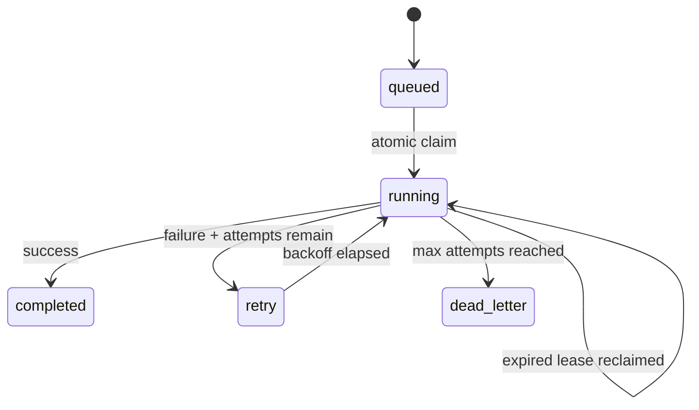

# Resilient Task Engine

[](https://github.com/Rajesh-444/resilient-task-engine/actions/workflows/ci.yml)


A durable background-job engine that demonstrates reliability patterns commonly hidden inside queue libraries: atomic claims, expiring leases, idempotent enqueueing, exponential retry backoff, and dead-letter handling.

It uses only Python and SQLite, making every state transition easy to run, test, and review.

## Why this project

"Run this later" becomes a systems problem as soon as processes crash or requests repeat. This engine answers the important questions explicitly:

- What stops two workers from claiming the same job?
- What happens when a worker dies after claiming work?
- How are duplicate requests made safe?
- When should a failed job retry, and when should it stop?

## State machine



An expired running lease can be reclaimed by another worker.

## Run the demo

```bash
PYTHONPATH=src python -m resilient_queue.cli --database demo.db
```

Run the tests:

```bash
PYTHONPATH=src python -m unittest discover -s tests -v
```

## Reliability guarantees

- Claims use `BEGIN IMMEDIATE` so only one SQLite writer can select and update a job at a time.
- An optional idempotency key returns the original job instead of adding a duplicate.
- Every claim has a lease deadline; abandoned jobs become reclaimable.
- Failures use capped exponential backoff.
- Jobs that exhaust their attempt budget enter `dead_letter` with the last error.
- Worker ownership is checked before completion or failure transitions.

The execution model is intentionally **at least once**. Handlers should therefore make their own external side effects idempotent.

## AI safety and execution guardrails

| Control | Behavior |
| --- | --- |
| Handler allowlist | Workers execute only explicitly registered in-process handlers; unknown jobs fail safely |
| Payload inspection | Rejects password, token, API-key, secret, and private-key fields at enqueue time |
| No arbitrary execution | Blocks command, shell, script, code, eval, and exec payload keys |
| Resource bounds | Limits payloads to 16 KiB, nesting to six levels, and job names to a constrained format |
| Ownership checks | Only the worker holding the active lease can complete or fail a job |
| Human authority | AI-generated tasks must map to reviewed handlers; free-form model output is never executed directly |

These controls reduce common agentic-AI risks such as tool misuse, secret propagation, and unbounded action payloads. Production handlers must still validate domain-specific authorization and make external side effects idempotent.

## Production roadmap

- PostgreSQL `FOR UPDATE SKIP LOCKED` backend
- Heartbeats for extending long-running leases
- Metrics for queue latency, retries, and dead-letter volume
- Admin API for replaying dead-lettered jobs
- Async workers, graceful shutdown, and OpenTelemetry spans

